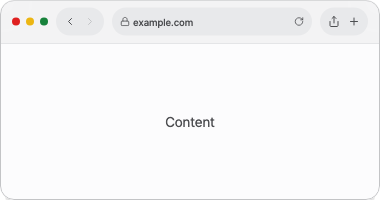
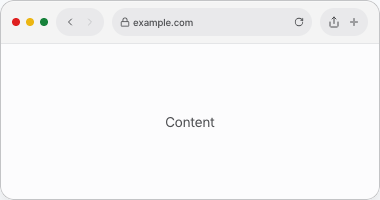
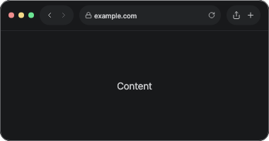
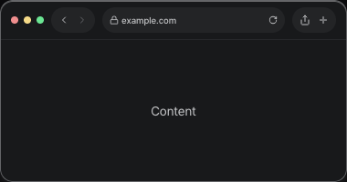

# MockupBrowser 구현 검증

이슈 #5341의 코드 구현과 런타임 프리뷰 증거입니다. Figma 라이브러리 게시와 디자이너의 캔버스 검수는 별도로 진행합니다.

- 기준 시안: [MockupBrowser 리디자인](https://www.figma.com/design/9FgsLhiWz0aLsVqcoI6nYJ/CoUI---Cocode-Design-System-v1.0?node-id=6956-20)
- 크기: 380×200, 배율 1. 콘텐츠는 전체 창을 채우고 자식 콘텐츠의 상단 여백은 44입니다.
- 툴바: 높이 44, 좌우 패딩 12, 그룹 간격 8, 배경 `surface-container-low` 88%, 블러 20, 아래 선 `surface-container` 1.
- 캡슐: 높이 28, 좌우 패딩 8, `surface-container` 70%, `radius9999`.
- 주소: `labelSmall`, 자물쇠·새로고침 10. 기본 도메인은 텍스트 폭을 따르고 명시적인 `addressBarTextAlign`은 기존처럼 남은 폭 안에서 정렬합니다.
- 자식 기본 텍스트: 시안의 14px에 대응하는 `bodySmall` / `onSurfaceVariant`.
- 창: `radius14`, 최상위 테두리 `outlineVariant` 1, 흰색 35% 안쪽 위 하이라이트. `CoreShadow.xl`은 이미 명세의 2단 값과 동일하여 MockupDevice와 함께 재사용합니다.
- `addressBar: null`은 탐색·주소·공유·새 탭을 모두 제거합니다. `showControls`는 신호등만 제거하며, 최상위 테두리는 자식의 클릭을 막지 않습니다.

| 모드 | Flutter | Web |
|---|---|---|
| 라이트 |  |  |
| 다크 |  |  |

Flutter 이미지는 회귀 테스트에서 저장소의 Lucide SVG 데이터를 아이콘 캐시에 등록한 뒤 실제 Flutter 엔진의 RepaintBoundary에서 촬영했습니다. Web은 SSR을 실제 Chrome에서 렌더한 저장소의 파리티 캡처입니다. 일반 Flutter 파리티 캡처는 기존 하네스가 아이콘 HTTP 로드를 완료하지 않아 아이콘 슬롯만 그립니다. 위 검수 이미지는 6개 SVG가 모두 렌더됐다는 테스트 assertion도 통과했습니다.

재현:

```sh
# 저장소 루트
dart run tool/parity/manifest.dart --components=mockup-browser --out=/tmp/mockup-browser.json
dart run tool/parity/capture_web.dart --manifest=/tmp/mockup-browser.json --out=/tmp/mockup-browser-captured

# packages/coui_flutter에서
MOCKUP_BROWSER_CAPTURE_DIR=/tmp/mockup-browser-evidence flutter test --no-pub test/components/display/mockup_browser_redesign_test.dart
PARITY_MANIFEST=/tmp/mockup-browser.json PARITY_OUT=/tmp/mockup-browser-captured flutter test --no-pub test/parity/flutter_capture_matrix_test.dart
```

전체 속성 파리티 비교기는 `OutlinedContainer`의 Web 전용 투명 그림자 자리도 레이어로 셉니다. 기본 스타일에서 Flutter는 2개, Web은 보이는 2개와 투명 1개를 반환하여 10개 테마 조합이 `boxShadow` 개수 차이로 실패합니다. 변경 전 기준 이미지의 JSON에도 동일한 차이가 있으며, 이 PR은 공통 컨테이너나 비교기의 판정을 변경하지 않습니다. 캡처 테스트와 컴포넌트 테스트는 통과했습니다. 이슈 #5319의 다크 툴바 토큰 검토와 Figma 사용처 교체·게시도 별도 검수 항목입니다.

기준 이미지 승격은 `.github/workflows/parity-baseline.yml`의 러너에서 수행합니다. 로컬 촬영의 Flutter SDK는 3.47.0, Web은 Chrome 150.0.7871.24이며 CI Flutter 3.47.5와 다르므로 로컬 캡처를 CI 기준 이미지로 승격하지 않았습니다. 새 코드가 게시된 뒤 `components=mockup-browser`로 재촬영합니다.

PR 검수용 플러그인은 이 PR 작업 폴더의 `tools/figma-token-sync/manifest.json`을 Figma Development 메뉴에서 가져옵니다. 이 번들은 PR 브랜치의 프리뷰이며, 생성 결과를 정식 반영으로 판정하는 main 빌드·캔버스 검수·라이브러리 게시 절차와 구분합니다. 플러그인의 빌드 출처에서 이번 브랜치와 커밋을 확인할 수 있습니다.

### Figma bar 후속 수정

bar를 최상위로 재삽입한 뒤 절대 배치를 다시 확정하도록 수정했습니다. 가로·세로 자동 크기 모드는 FIXED로 두고 최종 크기 380×44, 좌표 (0, 0), 가로 STRETCH·세로 MIN 제약을 적용합니다. 회귀 검사는 이전 빌더의 "pin 뒤 재삽입"을 실패로 잡고 수정 빌더에서는 통과합니다.

### Figma 채움·테두리 후속 수정

MockupBrowser의 `bar`·`nav`·`addr`·`actions`는 `tint` 보조 레이어를 제거하고 프레임 자체의 채움으로 생성합니다. Figma의 composed COLOR variable을 사용하여 원래 시맨틱 색상 변수에 투명도를 합성합니다. 같은 시맨틱 컬렉션의 모든 모드에 원본 색상 별칭을 연결하며, 재실행 시 같은 변수를 갱신합니다. 기본값에서는 `color/surface-container-low/opacity/88`, `color/surface-container/opacity/70` 두 파생 변수가 만들어집니다. 글자·아이콘을 포함한 프레임 opacity는 1입니다. 일반 시맨틱 토큰에 paint opacity만 쓰는 방식은 Figma 실제 테스트에서 88%·70% 모두 100%로 되돌아가고 같은 PNG를 출력했습니다. 새 API는 88% 알파의 PNG 픽셀(224/255)을 출력했습니다.

`window border`는 시안과 같은 RECTANGLE로 생성합니다. 기존의 빈 FRAME은 같은 INNER_SHADOW 값으로도 안쪽 하이라이트가 빠졌습니다. 실제 Figma export에서 위쪽 중앙 픽셀이 FRAME은 `(195,196,198,255)`, RECTANGLE은 `(216,217,218,255)`로 달라졌습니다. 선 정렬 INSIDE·두께 1·radius14·흰색 35% `(0,1)` 효과 설정은 시안과 대응합니다. 코드 색상의 8비트 알파는 89/255입니다.

Figma에서 생성 코드의 색상 별칭·채움 함수를 임시 사본에 적용하여 Light·Dark 렌더를 확인했습니다. 그룹은 `controls → nav → addr → actions`, 채움은 88%·70%, 프레임 opacity는 1, 최상위 테두리는 RECTANGLE입니다. 테스트 사본과 테스트 변수는 제거했습니다. 이 검증은 정식 Generate나 라이브러리 게시를 대신하지 않습니다.

Fidelity 검사는 파생 변수의 모든 모드 값과 원본 별칭을 확인한 경우만 투명 채움을 허용하고, 원래 Core 색상·투명도와 비교합니다. 실제 변수 이름을 컬렉션 이름과 합쳐 해석하여 `Semantic/ Color · CoUI` 컬렉션의 `color/*`도 검사합니다. Figma typings는 새 API를 포함한 1.141.0으로 올렸습니다. TokenDoc v1과 Dart 변수 내보내기는 이 합성 색상 형식을 지원하지 않으므로 두 파생 변수를 명시적으로 skipped에 보고하고 잘못된 RGB를 내보내지 않습니다. 파생 변수는 원본 토큰에서 다시 생성되며 독립적인 Core 토큰으로 취급하지 않습니다.

플러그인 전체 selftest, typecheck, 빌더 리터럴 검사가 통과했습니다. 최종 번들로 사람이 Generate한 결과의 검수는 남아 있습니다.

### 실제 데스크톱 Generate 중단 수정

`53a26b169` 번들의 실제 데스크톱 Generate는 bar 채움을 만들기 전에 중단됐습니다. 캔버스 readback은 창 380×100, 빈 bar 100×100이며 콘텐츠·controls·캡슐·window border가 없고 파생 변수도 없었습니다. 이것은 완성된 시각 결과가 아니라 부분 생성입니다.

원인 호출은 `createVariable(name, base.variableCollectionId, 'COLOR')`입니다. manifest가 `documentAccess: dynamic-page`이면 이 ID 문자열 overload는 예외를 던집니다. [Figma API 문서](https://developers.figma.com/docs/plugins/migrating-to-dynamic-loading/)도 컬렉션 객체를 전달하도록 정합니다. 이전 MCP 프로브와 테스트 double은 문자열 ID를 받아들여 실제 데스크톱 제약을 검증하지 못했습니다.

Generate에서 이미 비동기로 로드한 브랜드별 컬렉션 객체를 VarLookup에 전달하고 `createVariable(name, collection, 'COLOR')`로 수정했습니다. 테스트 double은 문자열 ID를 명시적으로 거부하고, 실제 VarLookup이 올바른 객체를 전달하는지 검사합니다. 새 변수가 색상 채움 선택기에만 나타나도록 FRAME_FILL·SHAPE_FILL scope도 지정합니다.

색상 별칭 생성은 MockupBrowser의 기존 내용을 지우기 전에 실행합니다. 네이티브 API 오류를 주입했을 때 기존 컴포넌트의 모든 자식이 보존되는 회귀 검사도 추가했습니다. 이것은 신규 변수 API의 실제 데스크톱 지원 여부나 최종 캔버스 렌더가 검증됐다는 뜻은 아닙니다. 수정 번들로 사람이 Generate한 실제 결과를 확인해야 합니다.
