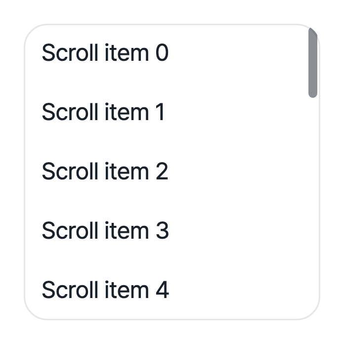
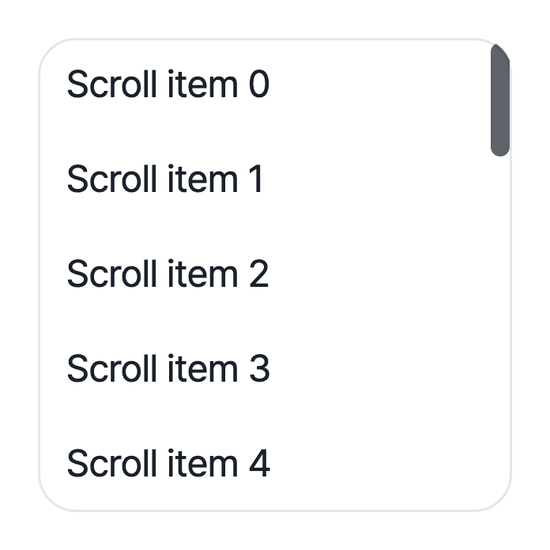
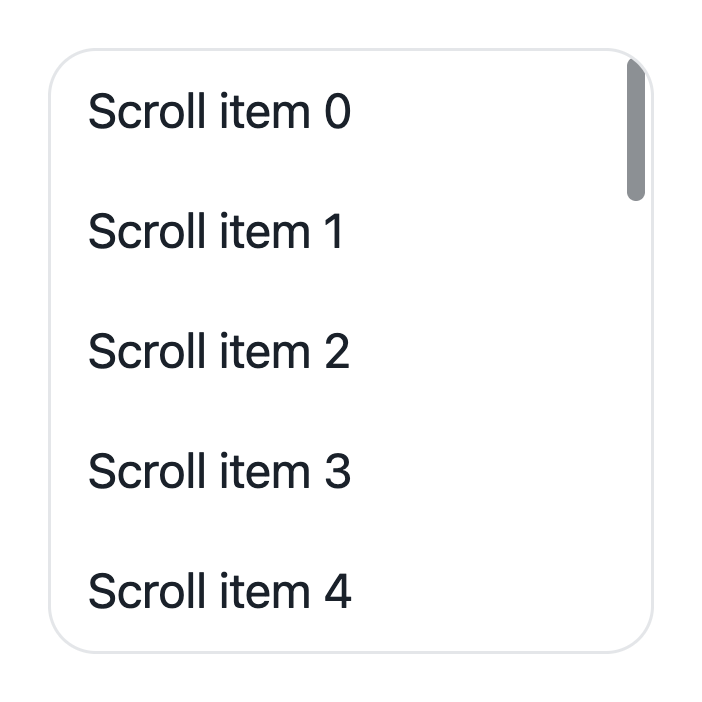
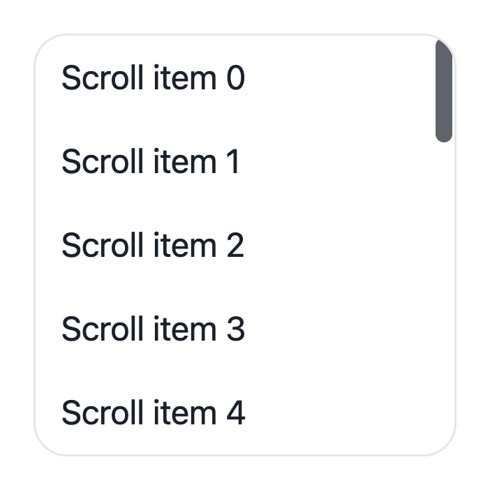
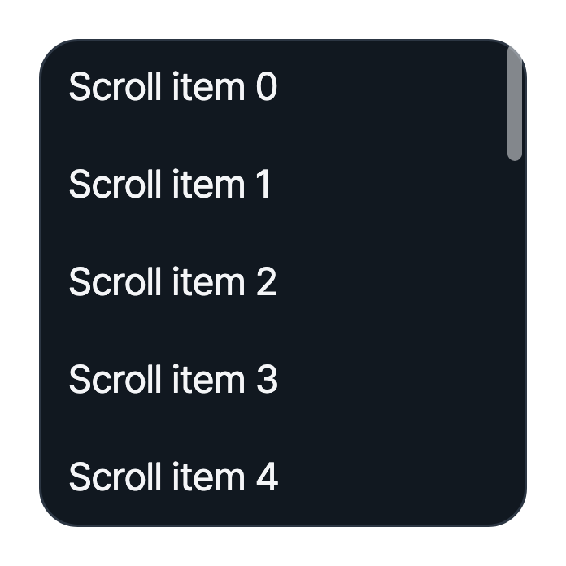
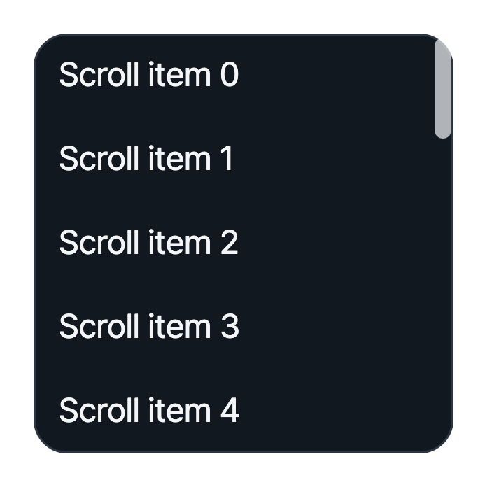
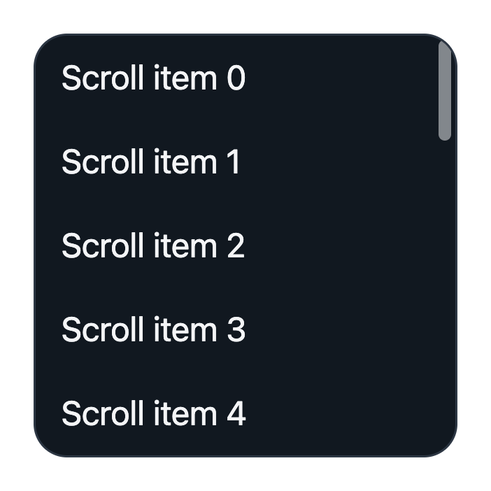
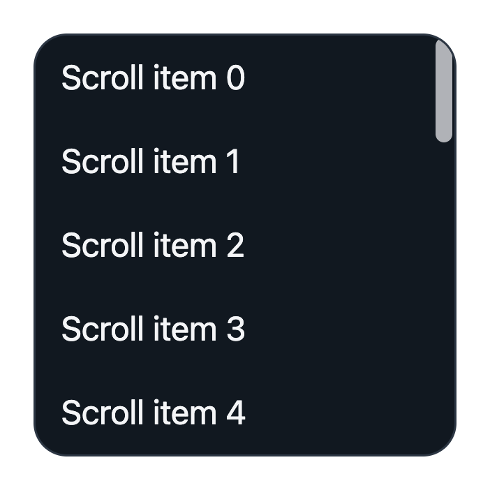

# Scrollbar 구현 검증

이슈 #5395의 코드 구현과 런타임 프리뷰 증거입니다. Figma 라이브러리 게시와 디자이너의 캔버스 검수는 별도로 진행합니다.

- 기준 시안: [Scrollbar (리디자인)](https://www.figma.com/design/9FgsLhiWz0aLsVqcoI6nYJ/CoUI---Cocode-Design-System-v1.0?node-id=7080-13784)
- 크기: 카드 200×200, 반경 16, 배율 1. 항목 40 높이 50개라 thumb 은 최소 길이 48 로 고정됩니다.
- 휴지: thumb 두께 6(`size6`) · 알약(`radius9999`) · 가장자리에서 사방 2(`space2`) · `on-surface` 50%. 바가 차지하는 폭 10.
- hover · 끌기: thumb 두께 8(`size8`) · `on-surface` 70%. 차지하는 폭 10 은 그대로이고 여백이 2 → 1 로 줄어듭니다.
- thin: 두 두께를 절반으로(3 · hover 4), 여백은 그대로, 폭 7.

| 모드 | Flutter 휴지 | Flutter hover | Web 휴지 | Web hover |
|---|---|---|---|---|
| 라이트 |  |  |  |  |
| 다크 |  |  |  |  |

Flutter 이미지는 `scrollbar_render_test.dart` 가 실제 Flutter 엔진의 RepaintBoundary 를 3배로 촬영한 것입니다. Web 이미지는 `resolveScrollbarCss` 가 내는 스코프 CSS 를 최소 페이지에 넣고 실제 Chromium 에서 렌더한 것입니다(`scrollbar_css_test.dart` 가 같은 규칙을 문자열로 고정합니다). 앱의 Tailwind 와 폰트는 싣지 않아 글자 모양은 두 이미지가 다릅니다. 보는 대상은 thumb 입니다.

## 확인한 것

**그려진 픽셀(Flutter)** — `scrollbar_render_test.dart` 가 라이트·다크에서 단일 픽셀을 읽습니다. 휴지에서 thumb 폭 6 · 오른쪽 가장자리 2 · 위쪽 여백 2 · 모서리 픽셀이 곡선에 걸치는 정도(사각형이면 전부 덮임)를, hover 에서 폭 8 · 가장자리 1 · 휴지의 여백 자리에 thumb 이 들어옴을 단언합니다. 모서리 단언이 정말 사각형을 잡는지는 `thumbRadius: zero` 대조군으로 확인했습니다.

**실제 Chromium 렌더(Web)** — 리졸버가 낸 CSS 로 측정했습니다.

| 항목 | 값 |
|---|---|
| 바가 차지하는 폭 | 10 (thin 7, 가로 바 높이 10) |
| 보이는 thumb | 폭 6, 가장자리 2 / 2 |
| 보이는 thumb 최소 길이 | 48 (border box 기준이라 CSS 에는 `+ 2 × 여백` = 52 를 냅니다) |
| 모서리 | 알약, 반경 4 모두 기준 `div` 와 픽셀 일치(최대 차이 0~1) — 투명 border 가 안쪽 반경을 깎아서 `calc(반경 + 여백)` 으로 보정합니다 |
| hover | 폭 8, 가장자리 1 / 1, `clientWidth` 190 → 190 (내용이 밀리지 않음) |
| 끌기 | 포인터가 thumb 밖으로 나가도 폭 8 유지 |
| fade 중 hover | 투명하게 사라진 thumb 도 hover 하면 보임 |

**파리티 기준 JSON** — `scrollbar` 8개 조합과 `fade-scroll` · `scroll-area` 32개 조합을 Flutter · Web 모두 다시 찍어 `test/parity/baseline/` 의 기존 JSON 80개와 비교했더니 **전부 바이트 단위로 동일**했습니다. 이 프로브는 루트 요소의 스타일 속성만 읽으므로 thumb(스크롤바 pseudo 요소)은 보지 못합니다. 기준 이미지가 움직이지 않는다는 뜻이지 thumb 이 맞다는 증거는 아닙니다 — thumb 은 위의 두 측정이 봅니다.

**대비** — `check_contrast.dart` 에 thumb 쌍을 편입했습니다. 합성 후 thumb 과 바탕의 대비(휴지 50%):

| | surface | surfaceBright | surfaceContainerHigh |
|---|---|---|---|
| 라이트 | 3.20 | 3.20 | 3.09 |
| 다크 | 4.94 | 4.45 | 4.10 |
| 고대비 라이트 | **3.95** | **3.95** | 3.84 |
| 고대비 다크 | 5.28 | 4.73 | 4.37 |

hover(70%)는 8개 스킴 × 8개 톤 전부 4.93 이상입니다. 고대비 라이트의 3.95 는 고대비 목표 4.5 에 못 미쳐 `contrast_baseline.txt` 에 이유와 함께 예외로 기록했습니다(비텍스트 3:1 은 통과). 이슈 본문의 숫자와는 다크 휴지 두 칸만 어긋납니다(이슈 4.88 · 4.41, 측정 4.94 · 4.45). 같은 칸의 hover 8.48 은 일치하므로 서피스 색은 같고, 어느 쪽 계산이 다른지는 이슈의 계산식을 못 봐서 단정하지 않습니다. 게이트가 정본입니다.

## 스펙이 말하지 않아 해석한 부분

- **thin 과 hover 의 조합.** 이슈는 thin 의 휴지 두께(6 × 0.5 = 3)만 적었습니다. 코드가 이미 "thin 은 해석된 두께를 절반으로" 이므로 hover 두께에도 같은 계수를 곱했고(8 × 0.5 = 4), 여백은 그대로 둡니다. 그 결과 thin 의 바 폭은 3 + 2 × 2 = 7, hover 때 여백은 1.5 입니다.
- **ScrollArea 의 thumb 25%.** `CoreScrollAreaStyle.defaultScrollbarStyle` 은 thumb 을 25% 로 덮어쓰고 있어 새 기본(50%, 3:1 기준)과 어긋납니다. 이번 이슈 범위 밖이라 그대로 두었고, 두께 6 덮어쓰기만 새 기본과 같은 값이 되어 지웠습니다(렌더 변화 없음).

## 한계

- **모서리 걸림.** 이슈 5번 "반경 12 · 16인 컨테이너 안에서 thumb 끝이 모서리에 잘리지 않는다" 는 스크롤 영역이 클립된 둥근 컨테이너의 가장자리에 맞닿으면 성립하지 않습니다. 위 이미지의 오른쪽 위가 그 경우입니다. 여백 2 에서 thumb 의 오른쪽 끝이 모서리 곡선에 걸리는 구간은 반경 12 에서 위에서 5.4px, 반경 16 에서 8.3px 이고(여백 0 이면 12 · 16), 스크롤 영역을 컨테이너 가장자리에서 3px 이상 안쪽에 두면 반경 16 에서도 걸리지 않습니다. 값은 스펙대로 두었습니다.
- Web 은 Chromium 만 측정했습니다. Safari 는 같은 `::-webkit-scrollbar` 규칙을 쓰지만 렌더를 확인하지 못했고, Firefox 는 색만 맞습니다(이슈에서 다루지 않기로 한 것).
- hover 전환이 Flutter 는 200ms 애니메이션(동작 줄이기에서는 즉시), Web 은 즉시입니다. Chromium 이 스크롤바 pseudo 요소의 transition 을 지원하지 않습니다. hover 가 시작되는 자리도 Flutter 는 바 위, Web 은 thumb 위입니다.
- `axis: both` 에서 두 바가 만나는 모서리 칸은 이번 변경 전에도 규칙이 없었고(Dark 에서 흰 네모), 이번에 10×10 으로 커졌습니다. 이번 범위 밖입니다.
- Figma 쪽은 빌더·selftest·`components.json` 까지 코드로 확인했습니다. 실제 Figma 에서만 확인되는 것이 남아 있습니다: 인스턴스 안 thumb 에 `x`/`y` 를 쓰는 것, thumb 노드의 `opacity` 변수 연결, 정식 Generate 뒤 `Scrollbar` 10×96 · thumb (2,2) 6×48 과 `⇄` 차이 0.

## 재현

```sh
# packages/coui_flutter 에서
flutter test --no-pub test/components/control/scrollbar_redesign_test.dart test/components/control/scrollbar_render_test.dart
SCROLLBAR_CAPTURE_DIR=/tmp/scrollbar-evidence flutter test --no-pub test/components/control/scrollbar_render_test.dart --plain-name "evidence"

# packages/coui_web 에서
dart test test/components/infra/scrollbar_css_test.dart test/components/layout/scroll_area_scrollbar_test.dart

# packages/coui_core 에서
dart test test/scrollbar_style_test.dart test/scrollbar_thumb_geometry_test.dart
dart run tool/check_contrast.dart --ci

# 저장소 루트에서 — 파리티 기준 JSON 비교
dart run tool/parity/manifest.dart --components=scrollbar,fade-scroll,scroll-area --out=/tmp/scrollbar.json
dart run tool/parity/capture_web.dart --manifest=/tmp/scrollbar.json --out=/tmp/scrollbar-captured
(cd packages/coui_flutter && PARITY_MANIFEST=/tmp/scrollbar.json PARITY_OUT=/tmp/scrollbar-captured flutter test --no-pub --tags parity test/parity/flutter_capture_matrix_test.dart)
```
